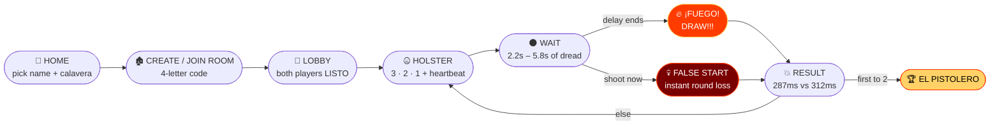
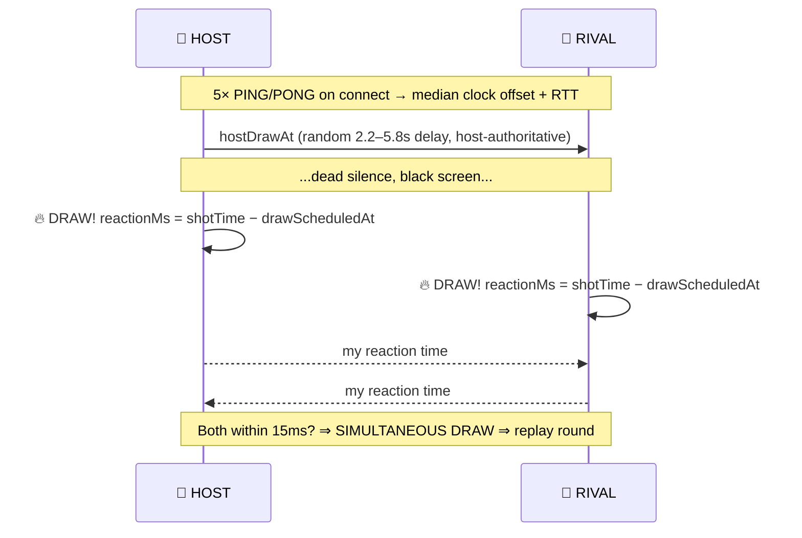

<div align="center">


<a href="https://dead-eye-duel.vercel.app">
  
</a>

<br/>

```
                       ▄▄▄▄▄▄▄▄▄▄▄▄▄▄▄▄▄▄▄▄▄▄▄▄▄▄▄▄▄▄▄▄▄▄▄▄▄▄
        ┌──────────────┤  ☠  H I G H   N O O N   ☠  ├───────────────┐
        │              ▀▀▀▀▀▀▀▀▀▀▀▀▀▀▀▀▀▀▀▀▀▀▀▀▀▀▀▀▀▀▀▀▀▀▀▀▀▀       │
        │                                                           │
        │   ▄▀▀▀▀▀▀▀▀▀▀▀▀▀▀▀▀█▄     ✦ ✦ ✦     ▄█▀▀▀▀▀▀▀▀▀▀▀▀▀▀▀▀▀▄   │
        │  ▐ ▄▄▄▄▄▄▄▄▄▄▄▄▄▄▄▄▄▀═══╗   ╔═══▀▄▄▄▄▄▄▄▄▄▄▄▄▄▄▄▄▄▄▄ ▌  │
        │   ▀▀▀▀▀▀▀▀▀▀▀▀▀▀▀▀▀▀▀ ╔═╝ ☼ ╚═╗ ▀▀▀▀▀▀▀▀▀▀▀▀▀▀▀▀▀▀▀▀▀   │
        │      P L A Y E R  1   ║ V S ║   P L A Y E R  2          │
        └───────────────────────────────────────────────────────────┘
```

<p>
  <a href="https://dead-eye-duel.vercel.app"></a>
  
  
  
</p>
<p>
  
  
  
  
  
  
</p>

<h3>
  <a href="https://dead-eye-duel.vercel.app">🎮 Play</a> ·
  <a href="#-how-the-duel-works">⚔️ The Duel</a> ·
  <a href="#-the-weapon-colt-peacemaker-45">🔫 Weapon</a> ·
  <a href="#-run-it-locally">🚀 Run It</a> ·
  <a href="#-easter-eggs--secrets">🥃 Secrets</a>
</h3>

</div>


## 💀 WHAT IS THIS?

> *"When the sun hits the top of the church tower, one of you ain't walking out of this cantina."*

**DEAD EYE DUEL** is a **mobile-first, two-player, real-time quick-draw game** where **your actual phone is the gun**. Put it in your pocket. Wait for the signal. Rip it out like a revolver. **First valid shot wins the round.** Best of 3 and you earn the title:

<div align="center">

# 🏆 ⋆｡°✩ EL PISTOLERO ✩°｡⋆ 🏆

</div>

No custom backend. No database. No server code. No audio files.
Just **React + WebRTC + pure synthesized sound + your twitchy wrist.**

<table align="center">
<tr>
<td align="center"><h2>0</h2><sub>BACKEND SERVERS</sub></td>
<td align="center"><h2>0</h2><sub>AUDIO FILES</sub></td>
<td align="center"><h2>6</h2><sub>CHAMBERS</sub></td>
<td align="center"><h2>6</h2><sub>CALAVERA AVATARS</sub></td>
<td align="center"><h2>∞</h2><sub>GRUDGES</sub></td>
</tr>
</table>


## ⚔️ HOW THE DUEL WORKS



### 🎬 THE FOUR PHASES OF DEATH

| Phase | Screen | What You Do | What Happens If You Screw Up |
|:-----:|:------:|:------------|:-----------------------------|
| **1 · HOLSTER** 🤐 | Countdown + heartbeat + haptic pulses | Phone away. Hands down. Breathe. | Nothing. Yet. |
| **2 · WAIT** 🌑 | **Pitch black.** Eyes staring across the void. | Stay frozen. Random 2.2–5.8s delay. | **FALSE START → you lose the round. Instantly.** |
| **3 · DRAW!** 🔥 | Screen flashes **RED**. Trumpets scream. **¡FUEGO!** | **SHOOT. NOW.** | You were too slow. Rest in peace. |
| **4 · RESULT** 💥 | Recoil, muzzle flash, cylinder spins +60°, bullet hole punched into the screen | Watch the ms comparison | Bullet holes **persist the whole match.** |

<div align="center">

```
   ROUND 1  ▸  ▮ ░         ROUND 2  ▸  ▮ ▮         MATCH  ▸  ☠ EL PISTOLERO ☠
   ─────────────────────────────────────────────────────────────────────────
     YOU  287ms  ⚡          YOU  301ms  ⚡          Mariachi fanfare + confetti
     RIVAL 312ms 💀         RIVAL 298ms 💀 ← lol      + REMATCH button ready
```

</div>


## 🔫 THE WEAPON: COLT PEACEMAKER .45

Drawn in **100% pure SVG**. No images. Every part is alive:

```
                    ┌─── front sight blade
                    ▼
   ╭───────────────╥─╮                          ░▒▓█ BOOM █▓▒░
   │▓▓▓▓▓▓▓▓▓▓▓▓▓▓▓║▓│══════════════◄── long octagonal steel barrel
   ╰──┬────────╥───╨─╯   ▲ ejector tube
      │  ◎ ◎   ║  ┌───────┐
   ┌──┴───┐  ╔═╩══╡ ⚙ ⚙ ⚙ │◄── 6-CHAMBER CYLINDER (rotates 60° per shot)
   │ ▓▓▓▓ │◄─╝    └───────┘
   │ blued│  ╱ ◄── COCKING HAMMER (cocks on draw, snaps on trigger)
   └──╥───┘ ╱
      ╚═══╗◄── curved trigger guard
          ▼
```

- 🔩 **Visibly rotating 6-chamber cylinder** — advances **60°** on every shot, with ratchet clicks
- 🪓 **Cocking hammer** — pulls back during the draw, snaps forward on trigger
- 💢 **Heavy recoil kickback**
- 💥 **Multi-point muzzle flash** + smoke ring
- 🎨 Blued engraved frame, screw accents, the works


## 📱 HOW SHOOTING WORKS

<table>
<tr>
<th width="33%">🤳 MOTION GESTURE</th>
<th width="33%">👆 TAP / SPACEBAR</th>
<th width="33%">📳 HAPTICS</th>
</tr>
<tr valign="top">
<td>

Rip the phone out of your pocket like a revolver.

- Uses `DeviceMotionEvent` + `DeviceOrientationEvent`
- Detects an upward acceleration spike **> 13.5 m/s²**
- Followed by a forward pitch tilt of **50° – 130°**
- **Sensitivity slider** in the Lobby
- **iOS 13+**: explicit `DeviceMotionEvent.requestPermission()` button

</td>
<td>

The coward's (and desktop's) way.

- Tap / click **anywhere**
- Hit **`SPACEBAR`**
- Auto-enabled on desktop or when motion permission isn't granted
- Optional "Tap to shoot" toggle in the Lobby

</td>
<td>

Feel the dread in your bones.

- `navigator.vibrate`
- 💓 Heartbeat pulses during holster
- 💥 Recoil kick on shot
- ❌ Angry buzz on false start

</td>
</tr>
</table>


## 🎶 100% PROCEDURAL AUDIO — ZERO MP3s

Every sound is **synthesized live** with the **Web Audio API**. Sub-millisecond latency. Not a single audio file is shipped.

| 🔊 Sound | 🧪 Recipe |
|:--|:--|
| 🔫 **Gunshot** | Exponential white/pink noise burst → steep **4.5 kHz** lowpass sweep → sub-bass punch **180 Hz → 32 Hz** |
| 🔧 **Revolver Cock** | Dual-stage metal clicks at **2600 Hz** + **3400 Hz** |
| 🎰 **Cylinder Spin** | Rapid 6-stage ratchet clicks |
| 💓 **Heartbeat** | Low sine "lub-dub" kicks during the holster countdown |
| 🎺 **Draw Stinger** | Morricone / mariachi brass chord (**C5 · E5 · G5**) on **¡FUEGO!** |
| 🏆 **Win Fanfare** | Triumphant Mexican brass melody |
| 🎼 **Western Whistle** | Dual sine glide with **5.5 Hz vibrato** |
| 🌬️ **Desert Wind** | Modulated pink noise through a bandpass filter |
| 💫 **Ricochet** | High-pitch slide **2600 Hz → 220 Hz** |


## ⚖️ FAIRNESS & NETWORK SYNC

*"Lag" is not an excuse in a duel.*



1. 👑 **Host-authoritative timing** — the host rolls the random delay and schedules `hostDrawAt`
2. 🏓 **Ping/Pong clock sync** — 5 samples on connect → median offset (`opponentClock − hostClock`) + RTT
3. ⏱️ **Local reaction math** — each device computes `reactionMs = localShotTime − localDrawScheduledAt`
4. 🤝 **15 ms draw window** — shots within 15 ms are a **simultaneous draw** and the round is replayed


## 🧰 TECH STACK

<div align="center">


</div>

| Layer | Tech | Why |
|:--|:--|:--|
| ⚛️ UI | **React (Vite)** | Instant HMR, tiny bundle |
| 🌐 Networking | **PeerJS / WebRTC** | Peer-to-peer. Free public broker for signaling. **No server.** |
| 🎨 Styling | **Tailwind CSS** | Mobile-first, fast |
| 🎞️ Animation | **Framer Motion** | Recoil, flashes, screen shake |
| 🔊 Audio | **Web Audio API** | Everything synthesized live |
| 📳 Sensors | **DeviceMotion / DeviceOrientation** | Phone = revolver |

```
Dead_Eye_Duel/
├── 📁 public/              # static assets
├── 📁 src/                 # the whole saloon
│   └── hooks/usePeer.js    # WebRTC / ICE config lives here
├── 📄 index.html
├── ⚙️ vite.config.js
├── 🎨 tailwind.config.js
├── 🎨 postcss.config.js
└── 📦 package.json
```


## 🚀 RUN IT LOCALLY

```bash
# 1️⃣ Load your ammo
npm install

# 2️⃣ Open the saloon doors
npm run dev

# 3️⃣ Forge for production
npm run build
```

### 🧪 Testing the Duel

<details>
<summary><b>🖥️ Option A — Two browser tabs, one computer (fastest)</b></summary>

1. Open `http://localhost:5173` in **Tab 1** (Host)
2. Click **CREATE ROOM** → copy the 4-letter code (e.g. `K9W2`)
3. Open `http://localhost:5173/?room=K9W2` in **Tab 2** (Rival) — or hit **Join Room** and type it
4. Both players click **READY TO DRAW**
5. Host clicks **START DUEL MATCH**
6. When **¡FUEGO!** appears → mash `SPACE` or click the screen 🔫

</details>

<details>
<summary><b>📱 Option B — Two real phones on the same Wi-Fi (the real deal)</b></summary>

```bash
npm run dev -- --host
```

Open the network IP (e.g. `http://192.168.1.X:5173`) on both phones.

> ⚠️ **Motion sensors require HTTPS.** For local testing with real sensors, tunnel it:
> ```bash
> ngrok http 5173
> ```
> Open the **HTTPS** ngrok URL on both phones → tap **ENABLE SENSORS** → pocket your phones → **DUEL.**

</details>


## 🌐 DEPLOY (HTTPS REQUIRED FOR SENSORS)

<table>
<tr>
<td width="50%">

### ▲ Vercel
```bash
npm install -g vercel
vercel
```

</td>
<td width="50%">

### 🟩 Netlify
```bash
npm run build
npx netlify deploy --prod --dir=dist
```

</td>
</tr>
</table>

### 🛠️ WebRTC NAT & TURN

Default STUN servers: `stun:stun.l.google.com:19302` and `stun:global.stun.twilio.com:3478`.

Players on strict corporate / cellular networks or symmetric NATs? Add a TURN server in **`src/hooks/usePeer.js`**:

```js
config: {
  iceServers: [
    { urls: 'stun:stun.l.google.com:19302' },
    // Optional TURN server credentials:
    // {
    //   urls: 'turn:your-turn-server.com:3478',
    //   username: 'user',
    //   credential: 'password'
    // }
  ]
}
```


## 🥃 EASTER EGGS & SECRETS

| | Secret | How |
|:-:|:--|:--|
| 🌵 | **TEQUILA MODE** | Click the **cactus button** (top-left of Home). Your screen starts doing a drunken heat-wave wobble. |
| 🕳️ | **Persistent Bullet Holes** | Every shot punches a cracked crater into the screen. They stay all match. |
| 💀 | **6 Calavera Avatars** | *El Pistolero · La Calavera · El Bandido · Don Roberto · La Muerte · Señorita Sombra* |
| 🪵 | **Wooden Scoreboard** | Scratched tally marks for best-of-3. |

<div align="center">

### 💀 CHOOSE YOUR FIGHTER

| 🤠 | 💀 | 🔪 | 🎩 | ☠️ | 🕶️ |
|:-:|:-:|:-:|:-:|:-:|:-:|
| **El Pistolero** | **La Calavera** | **El Bandido** | **Don Roberto** | **La Muerte** | **Señorita Sombra** |

</div>


## 🗺️ ROADMAP

- [x] 📱 Phone-as-revolver motion detection
- [x] 🌐 Serverless P2P duels over WebRTC
- [x] 🎶 Fully procedural audio engine
- [x] 🤥 False-start punishment
- [x] 🥃 Tequila Mode
- [ ] 🏟️ Spectator mode
- [ ] 🧾 Global leaderboard of fastest draws
- [ ] 🤠 Tournament brackets
- [ ] 🎭 More avatars & weapons

## 🤝 CONTRIBUTING

Think you're faster than the dev? Prove it.

```bash
git clone https://github.com/pathakjiop/Dead_Eye_Duel.git
cd Dead_Eye_Duel && npm install && npm run dev
```

Fork it → branch it → ship it → open a PR. 🔫

<div align="center">

<br/>

<a href="https://dead-eye-duel.vercel.app">
  
</a>

<br/><br/>

**Made with 🔥, 🌵 and a dangerously twitchy trigger finger by [@pathakjiop](https://github.com/pathakjiop)**

<sub>⭐ Star this repo or the sheriff comes for you ⭐</sub>


</div>
