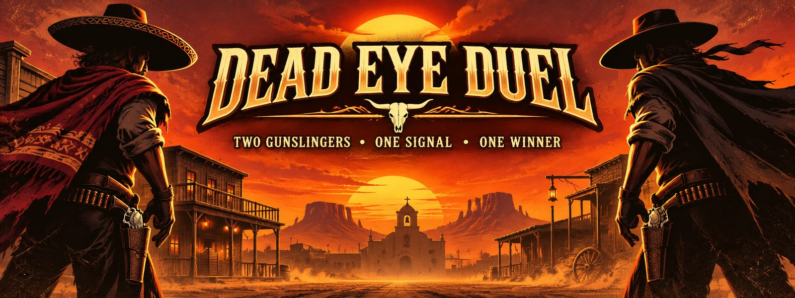
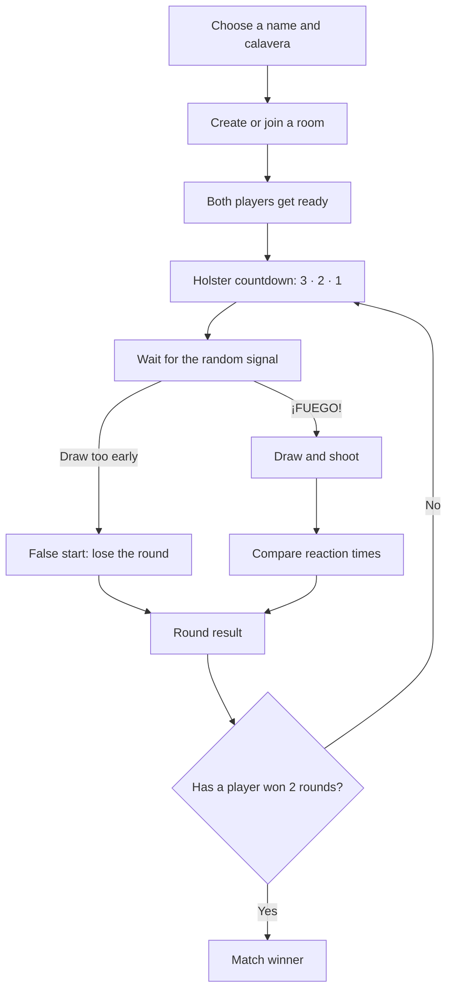

<div align="center">



### TWO GUNSLINGERS · ONE SIGNAL · ONE WINNER

**A real-time, mobile-first quick-draw game. Your phone is the revolver.**

[](https://dead-eye-duel.vercel.app)
[](https://react.dev/)
[](https://vite.dev/)
[](https://peerjs.com/)
[](https://tailwindcss.com/)

[**Play the game**](https://dead-eye-duel.vercel.app) · [How it works](#-the-duel) · [Tech stack](#-built-with) · [Run locally](#-run-locally) · [Contribute](#-contributing)

</div>

---

## 🌵 The story

The street is quiet. Your rival is watching. Keep your phone holstered, wait for the signal, then draw as fast as you can.

**Dead Eye Duel** is a two-player reaction game built around a simple idea: use your phone's motion sensors to perform a quick-draw gesture. Play online with a friend, compare reaction times, and try to become **El Pistolero**.

No dedicated game backend or database is required. Players connect through **PeerJS/WebRTC**, while the game handles round timing, reactions, sound effects, and match results in the browser.

## ⚔️ The duel

A match is played as a best-of-three: the first player to win two rounds takes the match.



### Round phases

| Phase | What happens | Your move |
|---|---|---|
| **1. Holster** | A three-second countdown builds tension. | Keep your phone down. |
| **2. Wait** | The game waits a random **2.2–5.8 seconds**. | Stay still. Drawing early is a false start. |
| **3. ¡FUEGO!** | The draw signal appears for both players. | Pull and aim, tap the screen, or press `Space`. |
| **4. Result** | Reaction times and the round winner are shown. | Get ready for the next round. |

**Fair-play rules:** a false start forfeits the round. Shots within **15 ms** of each other count as a simultaneous draw. The host coordinates the round and sends the result to the other player.

## 📱 Your phone is the revolver

Choose the input method that suits your device:

- **Motion draw:** uses `DeviceMotionEvent` and `DeviceOrientationEvent` to detect a quick movement and forward-facing phone angle.
- **Adjustable sensitivity:** the default acceleration threshold is **13.5 m/s²**. The threshold can be adjusted in the lobby; the accepted pitch range is **45°–135°**.
- **Tap / keyboard fallback:** tap or click to shoot, or press `Space` on a keyboard.
- **Permission handling:** browsers that require motion access (including supported iOS versions) can request it from the lobby.
- **Haptics:** vibration feedback is used when the browser and device support it.

> **Mobile tip:** motion-sensor access is restricted by some browsers and generally requires a secure HTTPS origin. Grant the requested permission, or switch to tap mode if sensors are unavailable.

## 🔫 A little theatrical flair

The duel is more than a timer:

- An animated six-chamber revolver, with a **60° cylinder turn** on each shot.
- Hammer, recoil, muzzle-flash, and smoke animations.
- Procedurally generated sound effects through the **Web Audio API** — no bundled MP3 sound files are needed for the game effects.
- Six selectable calavera characters.
- A desert-western visual theme, a match scoreboard, bullet-hole effects, and a playful Tequila Mode.

## ⚖️ How online timing works

Dead Eye Duel uses PeerJS to establish a peer-to-peer WebRTC data connection. Once connected, the players exchange game events over that connection.

1. The host schedules the draw after the holster countdown and a random delay.
2. The connection performs **five ping/pong samples** to estimate clock offset and round-trip time.
3. Each player measures their reaction against the locally scheduled draw time.
4. The host evaluates the reported shots. A difference of **15 ms or less** is treated as a simultaneous draw.

Peer-to-peer connectivity can depend on the players' networks and NAT configuration. The app currently configures Google and Twilio STUN endpoints in `src/hooks/usePeer.js`; restrictive networks may need a TURN service.

## 🧰 Built with

| Area | Technology | Role |
|---|---|---|
| UI | React 18 | Component-based game screens and state |
| Development / build | Vite 5 | Local development and production build |
| Styling | Tailwind CSS 3 | Responsive visual design |
| Animation | Framer Motion | Motion, recoil, transitions, and effects |
| Multiplayer | PeerJS + WebRTC | Room connections and peer data messages |
| Sound | Web Audio API | Synthesized game audio |
| Device input | Device Motion / Orientation APIs | Motion-based quick-draw input |
| Effects | Canvas Confetti, Lucide React | Match celebration and interface icons |

## 📁 Project structure

```text
Dead_Eye_Duel/
├── public/
│   ├── dead-eye-duel-banner.jpg
│   ├── favicon.svg
│   └── manifest.json
├── src/
│   ├── components/       # Revolver, avatars, backgrounds, visual effects
│   ├── game/             # Rules, constants, avatars, reducer, sound engine
│   ├── hooks/            # Peer connection, motion input, sound hooks
│   ├── screens/          # Home, create/join, lobby, duel, match result
│   ├── App.jsx
│   ├── index.css
│   └── main.jsx
├── index.html
├── package.json
├── postcss.config.js
├── tailwind.config.js
└── vite.config.js
```

## 🚀 Run locally

**Requirements:** Node.js and npm.

```bash
# Clone the repository
git clone https://github.com/pathakjiop/Dead_Eye_Duel.git
cd Dead_Eye_Duel

# Install dependencies
npm install

# Start the development server
npm run dev
```

Open the local Vite URL shown in your terminal.

### Test with two players

1. Open the game in two browser tabs or on two devices.
2. In the first tab, create a room and share its four-character room code.
3. In the second tab, join using that code.
4. Both players select **Ready**. The host starts the match once both are ready.
5. Wait for **¡FUEGO!**, then draw using motion, tap, or `Space`.

For two phones on the same Wi-Fi, expose the Vite dev server to your network:

```bash
npm run dev -- --host
```

Open the network URL on both devices. Use an HTTPS tunnel or HTTPS deployment when testing motion sensors on devices that require a secure context.

## 📦 Build for production

```bash
npm run build
npm run preview
```

The production site is generated in `dist/`. Deploy that directory to a static hosting provider such as Vercel or Netlify. Use HTTPS for the most reliable mobile sensor support.

## 🗺️ Future ideas

- [ ] Spectator mode
- [ ] Global reaction-time leaderboard
- [ ] Tournament brackets
- [ ] More characters and weapon variations

## 🤝 Contributing

Found a bug or have an idea for the next showdown? Contributions are welcome.

1. Fork the repository.
2. Create a feature branch.
3. Make and test your changes (`npm run build`).
4. Open a pull request with a clear description.

```bash
git clone https://github.com/pathakjiop/Dead_Eye_Duel.git
cd Dead_Eye_Duel
npm install
npm run dev
```

---

<div align="center">

**Think you're faster?** [Step into the duel.](https://dead-eye-duel.vercel.app)

Made with 🔥, 🌵, React, and a dangerously twitchy trigger finger by [@pathakjiop](https://github.com/pathakjiop).

</div>
